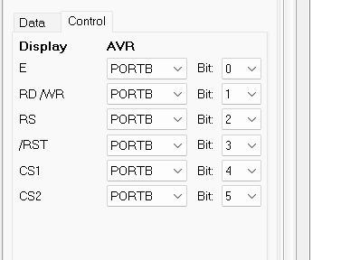

# ATmega32 Two-Axis Laser Engraver

My final project for the Microprocessors course at the University of Kashan (2023).
Sina Mozaffari Rad.

This is the controller for a small X/Y laser engraver, written in C for an ATmega32 and tested in a Proteus
simulation. You enter up to five shapes with a 4×4 keypad and a 128×64 graphic LCD. The firmware saves them in
EEPROM, turns each shape into motor steps, and drives two stepper motors and the laser to draw it. While the
head moves, the same path is drawn on the LCD, so you can follow the job on the screen.

Everything runs bare-metal on the 8-bit AVR at 8 MHz (CodeVisionAVR), with no RTOS. I control every peripheral
through its registers.

## Hardware

```
                 ┌────────────────────────────┐
  4x4 Keypad ───►│ PORTC   (row/col scanning) │
                 │                            │
                 │          ATmega32          │── PORTA[7:0] ──► KS0108 GLCD data bus
                 │          8 MHz             │── PORTB[5:0] ──► GLCD control (E, R/W, RS, /RST, CS1, CS2)
                 │                            │── PORTB7     ──► Laser (LED in simulation)
                 │  EEPROM: shapes + config   │── PORTD[3:0] ──► L293D ──► X-axis stepper
                 │                            │── PORTD[7:4] ──► L293D ──► Y-axis stepper
                 └────────────────────────────┘
```

| Port / pin | Direction | Function |
|---|---|---|
| `PORTA[7:0]` | Out | GLCD data bus DB0–DB7 |
| `PB0` | Out | GLCD **E** |
| `PB1` | Out | GLCD **RD/WR** |
| `PB2` | Out | GLCD **RS** |
| `PB3` | Out | GLCD **/RST** |
| `PB4` / `PB5` | Out | GLCD **CS1** / **CS2** (the two KS0108 halves) |
| `PB7` | Out | Laser on/off |
| `PORTC[3:0]` / `PORTC[7:4]` | In/Out (swapped while scanning) | Keypad rows / columns |
| `PORTD[3:0]` | Out | X stepper coils (through L293D) |
| `PORTD[7:4]` | Out | Y stepper coils (through L293D) |

GLCD settings in CodeVisionAVR:



In Proteus I used an `ATMEGA32`, a 128×64 GLCD with two KS0108 controllers, the `KEYPAD-SMALLCALC` keypad,
two L293D H-bridges, two `BISTEPPER` motors, and a green LED in place of the laser.

## How it works

When it starts, the LCD asks for a mode:

**1. Job editor.** Shows the five shape slots. You pick one and either edit it or define a new shape:

| Shape | What you enter |
|---|---|
| Line | start `(x1, y1)`, end `(x2, y2)` |
| Rectangle | two opposite corners |
| Circle | center `(x, y)` and radius `r` |
| Circular sector | center, start point and end point |

**2. Machine settings.** Table size (default 128 × 64, the same as the LCD) and motor speed in RPM (default 60).

**3. Run.** Draws all shapes in order. For each one the head moves to the start point, the laser turns on, and
the shape is traced step by step. I flip `y` on the LCD so the origin is bottom-left, like on a real machine.

| Key | Meaning |
|---|---|
| `0`–`9` | Digits and menu choices |
| `=` | Confirm a number |
| `+` | Edit / yes |
| `−` | No, or edit RPM in mode 2 |
| `ON/C` | Back / exit |

Before moving, every shape is checked against the table size (points outside the table, a circle that is too
big, a rectangle with zero width), so the head never tries to go out of range.

## Implementation notes

### Drawing shapes with motor steps

In this machine one motor step is one pixel, so I could use the classic raster graphics algorithms directly for
motion:

- **Line:** integer Bresenham. The axis with the bigger distance steps every time, and the error term decides
  when the other axis steps. No floating point in the loop.
- **Rectangle:** four straight edges, back to the start corner.
- **Circle:** the midpoint circle algorithm (`d = 3 − 2r`). I compute only one eighth of the circle and visit
  the other seven points by symmetry.
- **Sector (arc):** the radius is the distance from the center to the start point, the angles come from
  `atan2`, and I move in angle steps of `Δθ / (2πr)`, so two points are about one step apart. It works in
  both directions.

The head position (`xhead`, `yhead`) is kept in software. There are no encoders, so it is open-loop.

### Stepper control

Each axis has a 4-step coil table for each direction. If every move started the sequence from the first entry, the
motor would jump at the start of each move. So before a move I read the current coil pattern back from
`PORTD` and continue the sequence from there. The step delay comes from the
RPM setting:

```
ms_per_revolution = 60 000 / RPM
ms_per_step       = ms_per_revolution / 4      (4 full steps per revolution in the model)
```

### EEPROM layout

Everything that must survive a power cut is in one array, `eeprom char data[38]`:

| Offset | Content |
|---|---|
| `7·i + 0` | Shape type of slot *i* (`0` none, `1` line, `2` rectangle, `3` circle, `4` sector), *i* = 0…4 |
| `7·i + 1 … 7·i + 6` | Up to six coordinate bytes |
| `35` | Table width (X) |
| `36` | Table height (Y) |
| `37` | Motor speed (RPM) |

### Keypad

The keypad uses the row/column reversal method: I drive the rows and read the columns, then swap the
directions and read again. Debouncing is just waiting until the key is released.

## What I plan to improve

- Step timing uses blocking `delay_ms`, so the CPU does nothing else during a move. A timer interrupt for the
  steps would be the right way.


## Files

```
.
├── PROJECT.c                 # All firmware source (CodeVisionAVR C)
├── PROJECT.prj               # CodeVisionAVR project (chip, clock, GLCD and memory settings)
├── Debug/Exe/
│   ├── PROJECT.hex           # Compiled firmware (Proteus loads this)
│   └── PROJECT.eep           # EEPROM image
├── proteus/
│   └── TEST_PROJECT.pdsprj   # Proteus schematic and simulation
└── docs/
    └── glcd-pin-config.png   # KS0108 pin settings
```

## Build and simulate

You need CodeVisionAVR 3.x and Proteus 8.x.

1. Open `PROJECT.prj` in CodeVisionAVR and build it (ATmega32, 8 MHz). The output is `Debug/Exe/PROJECT.hex`.
2. Open `proteus/TEST_PROJECT.pdsprj`. The ATmega32 already points to `..\Debug\Exe\PROJECT.hex`, so the
   included build works without recompiling.
3. Start the simulation: mode `2` to check the table size and speed, mode `1` to define shapes, and mode `3`
   to run the job and watch the motors, the laser LED and the LCD.
